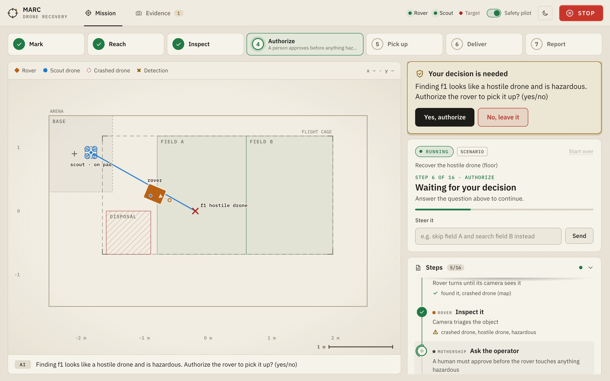
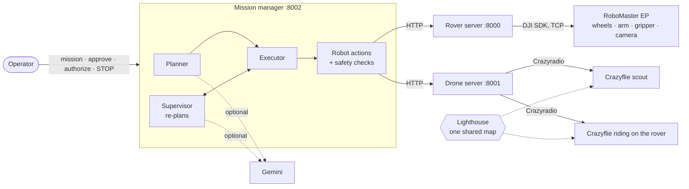

# MARC

**A scout drone and a ground robot that find and recover crashed drones in a field, with a person approving every risky step.**



## Why

Drones come down in fields: our own after a fault, hostile ones after an attack, some still carrying explosives.
Today a person walks out to find them. MARC sends robots instead and keeps the person at the screen, where they
approve the plan and decide whether a hazardous object may be touched.

## What happens in a mission

1. **You type the mission:** *"A hostile drone crashed in field A. Find it and take it to the disposal zone."*
2. **MARC plans it** as a short list of robot steps and shows you the plan. Nothing moves until you press **Approve**.
3. **The scout drone searches** the field in lanes and hovers over what it finds, so it shows up on the map.
4. **The rover drives there**, faces the object and photographs it: our drone, a hostile one, or not a drone at all.
5. **You authorize the pick-up** if it is hazardous. The gripper will not close on it without your yes.
6. **The rover picks it up and delivers it**: hostile drones to the disposal zone, our own back to base.
7. **A mission report** with the plan, every step and the photos is written at the end and prints to PDF.

If something changes on the way (nothing found, it turns out to be ours, a step fails, you type a new instruction),
MARC re-plans the remaining steps. **STOP** halts the rover and lands the drone at any moment.

## How it works



- **One map for both robots.** The scout flies in the Lighthouse tracking frame. A second Crazyflie rides on the rover
  with its motors off, so the rover's position is in that same frame, to a few centimetres. A spot the drone marks
  is a spot the rover can drive to.
- **AI is optional.** With a Gemini key, plans and re-plans come from the model and the rover camera is understood
  by a vision model. Without one, MARC uses built-in plans and rules, and the rover lines its gripper up on the
  marked position instead of the image.
- **Safety lives in code, not in a prompt.** Flight-area limits, a safety-pilot switch that locks the drone, a
  minimum distance between a low drone and the rover, the authorization gate on the gripper, a watchdog, and STOP.

More: [architecture and data flow](docs/architecture.md) · [API and robot actions](docs/reference.md)

## Try it without robots

Python 3.10 or newer:

```bash
python -m venv .venv && .venv/bin/pip install -r requirements.txt
.venv/bin/python start.py demo        # simulated rover and drone, opens http://localhost:8002
```

On the dashboard, pick **Hostile drone in field A** and press **Approve**. The tests run the same simulation:
`.venv/bin/python -m pytest` (about 400 tests, under a minute).

## Run it with the robots

You need a DJI RoboMaster EP, two Crazyflies with Lighthouse decks, Lighthouse base stations and a Crazyradio.

```bash
.venv/bin/python start.py floor --rover 192.168.2.1 --no-ai
```

Setup, calibration and the floor checklist: [docs/hardware.md](docs/hardware.md).

## Repository

| Folder | What is in it |
| --- | --- |
| [manager/](manager/) | The mission manager: planner, supervisor, executor, robot actions, safety, localization, and the dashboard |
| [rover/](rover/) | HTTP server for the RoboMaster EP over its plain-text SDK, plus a keyboard teleop page |
| [drone/](drone/) | HTTP server for the Crazyflies (flight, geofence, Lighthouse status) and the base-station calibration |
| [camera/](camera/) | Streams an overhead webcam to the mission manager |
| [scenarios/](scenarios/) | Ready-made missions, for the simulator and for the measured floor |
| [tests/](tests/) | Simulated robots, fake robot servers, and dashboard tests in a headless browser |
| [prototype/](prototype/) | The first single-file version, from the morning the hackathon started |
| [docs/](docs/) | Architecture, API reference, hardware setup, and the [build log](docs/history/README.md) |

`start.py` starts whatever a mode needs (`demo`, `sim`, `floor`) and reports anything that is missing in one line.

## Status

MARC was built in two days and runs end to end in the simulator. On the real floor the scout flew, marked and
returned to its pad, and the rover drove to the marked spot and gripped the object. Known limits:

- The Crazyflies carry no camera, so the scout's "seeing" is simulated: an object counts as found when the scout
  passes over its known position. An overhead camera module ([manager/overhead.py](manager/overhead.py)) is the
  planned replacement.
- The vision-model steps work in the simulator; on the real rover they depend on Gemini quota.
- The arm presets and the gripper reach are estimates and need measuring on each rover.

## Team

Built at a mobile robotics hackathon in Dresden, 10–11 October 2026, by:

| | | |
| --- | --- | --- |
| **Het Patel** | [@IamHetPatel](https://github.com/IamHetPatel) | Mission manager (planning, supervision, safety, robot actions), dashboard, simulator and tests, rover localization |
| **Viraj Dalsania** | [@Viraj5503](https://github.com/Viraj5503) | Drone server and Crazyflie flight, flight-cage measurement, rover pick-up and mark-and-pick flow |
| **Aryan Sanjay Nagbanshi** | | Rover server on the EP SDK, overhead camera, `start.py` launcher, wiring the robots into the dashboard |
| **Arshnoor Singh** | | Rover browser control and rover documentation |
| **Jonathan Daniss** | [@john-debug-masterman](https://github.com/john-debug-masterman) | |
| **Priyanshu Sankhala** | [@priyanshusankhala](https://github.com/priyanshusankhala) | |
| **Pankit Brahmkhatri** | [@pxnkit](https://github.com/pxnkit) | |

How the project came together, day by day: [docs/history](docs/history/README.md).

## License

[MIT](LICENSE). The dashboard bundles the IBM Plex fonts under the SIL Open Font License.
