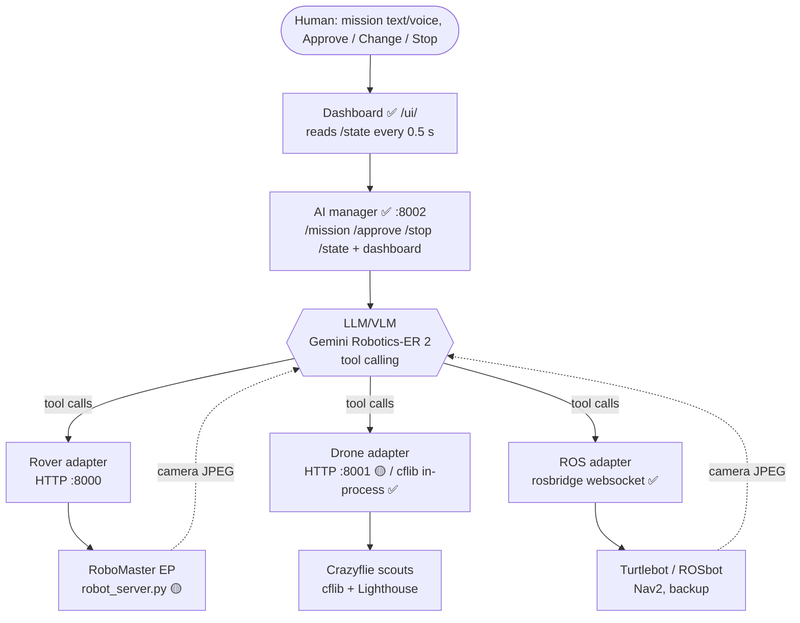

# FleetPilot: orchestration guide

One sentence in, a fleet of different robots out. An LLM/VLM splits the job between a fast drone (finds things) and a slow ground robot (verifies and fetches), checks its own work with the robot camera, and a human stays in control.

This README is for everyone (humans and coding agents) working on the repo. It explains **how the pieces talk to each other**, **what exists today**, and **what each squad must build against**. For the hackathon schedule, jury criteria and squad deadlines, see [FleetPilot – Hackathon Team Plan.md](FleetPilot%20–%20Hackathon%20Team%20Plan.md).

> **Status legend** used below: ✅ in this repo · 🟡 planned, specified in the Team Plan, not in this repo yet · ⚠️ known gap or sharp edge.

---

## 1. Architecture



Four layers: **dashboard → AI manager → adapters → robots**. The rule that keeps it parallelisable: *the LLM only ever sees plain Python tool functions* (`scout_area`, `ground_go_to`, …). It never knows which robot is real, simulated or mocked. If a robot dies, swap its adapter; the mission keeps running.

### The control loop (every orchestrator in this repo follows it)

```
plan → (human approves) → act via tools → look (camera) → verify → continue / re-plan / report
```

- **Plan**: LLM turns the sentence into steps and picks which robot does what.
- **Act**: LLM calls tools. We use `google-genai` *automatic function calling*, so the SDK runs the call loop and executes our Python functions for us.
- **Verify**: a camera frame goes back to the model ("is this the red cup? is it grippable?"). Never trust dead-reckoning alone.
- **Human**: approve / change / stop. ⚠️ Not implemented in code yet (see §5).

---

## 2. Files in this repo

| File | What it is | Orchestration role |
| --- | --- | --- |
| [fleet.py](fleet.py) | **Main multi-robot orchestrator.** Crazyflie scouts + RoboMaster EP, ROS-free, one shared Lighthouse frame. | The reference implementation of drone-finds / rover-fetches. |
| [brain.py](brain.py) | **Single-robot closed loop.** Look → decide → act → look, VLM sees the camera each turn. | The verify-with-camera pattern, against the rover HTTP API. |
| [fleet_agent.py](fleet_agent.py) | **ROS 2 adapter layer** over rosbridge (`roslibpy`). One `Robot` class per platform. | Backup path if we get a Turtlebot/ROSbot instead of (or in addition to) the EP. |
| [gesture_teleop.py](gesture_teleop.py) | Webcam hand gestures → `/speed`. | Manual override / demo extra. Not part of the AI loop. |
| `robot_server.py` 🟡 | HTTP server on the Windows laptop wrapping the RoboMaster SDK. | **Referenced by every file above but not in this repo.** Rover squad owns it. |

All Python files use env vars for config; none take a config file.

| Env var | Used by | Meaning |
| --- | --- | --- |
| `GEMINI_API_KEY` | all LLM files | Gemini credentials. |
| `MODEL` | all LLM files | Defaults to `gemini-robotics-er-2-preview`. Fallback: `gemini-robotics-er-1.5-preview`. |
| `ROBOT` | fleet, brain, gesture_teleop | Rover server base URL, default `http://localhost:8000`. |
| `SCOUTS` | fleet | Comma-separated Crazyflie radio URIs of flying drones. |
| `RIDER` | fleet | Radio URI of the **unarmed** Crazyflie taped to the EP (gives the EP its pose). |
| `ROBOTS` | fleet_agent | `name=host:port,…` of rosbridge endpoints. |
| `MOCK=1` | fleet, fleet_agent | Fake robots, no hardware, no `cflib`/`roslibpy` import. ⚠️ `brain.py` has **no** mock mode. |

---

## 3. Shared conventions (the contract)

Break these and the robots end up in different places. Everyone builds against them.

1. **One frame.** Every position is **metres in the drone's Lighthouse frame**. Arena is roughly `x 0..4`, `y 0..3`.
2. **Yaw in degrees** at the HTTP/cflib boundary, **radians** for Nav2 goals (`fleet_agent.go_to`).
3. **How the rover gets a pose in that frame** (shared-map options, best first):
   1. ✅ *Rider* (what `fleet.py` implements): a spare Crazyflie + Lighthouse deck taped on the EP, motors never armed. We only *read* `stateEstimate.x/y/yaw`.
   2. 🟡 Fallback: start the EP on a tape cross at a known spot/heading and use wheel odometry (`/pose`). Drifts over a few metres.
   3. 🟡 ArUco + overhead camera.
4. **Sensing split.** Drones cannot identify things. They only report *"something sticks up from the floor at (x, y)"*, detected as a dip in the downward range sensor (`range.zrange`) below the median floor distance by `DIP_M` (0.12 m). The rover's camera + VLM does identification.
5. **Tool docstrings are the prompt.** `google-genai` turns each function's name, type hints and docstring into the tool description the model sees. Write them for the model: state units, frame, limits and side effects.
6. **Tools return dicts/strings, not exceptions.** Return `{"arrived": False, …}` so the model can re-plan. Don't raise into the SDK loop.
7. **Safety caps live in the adapter, not the prompt.** Don't rely on the model to behave:
   - `fleet_agent.drive`: linear clamped to ±0.2 m/s, duration hard-capped at 5 s, zero-velocity published at the end.
   - `fleet.ground_go_to`: speed clamped to ±0.3 m/s, 30 s timeout, `/stop` on exit.
   - `brain.py`: system prompt asks for ≤ 1 m per step (⚠️ prompt only, not enforced in `move`).
8. **Flight rules.** Drones fly only in the cage/test zone, with a mentor present for every flight and field run.

---

## 4. How each orchestrator works

### 4.1 `fleet.py`: drone finds, rover fetches (main demo)

Tools exposed to the LLM:

| Tool | Does | Notes |
| --- | --- | --- |
| `scout_area(x_min, y_min, x_max, y_max)` | Splits a lawnmower path (0.4 m lane spacing, `FLY_Z` = 0.6 m) across all `SCOUTS`, flies them in parallel threads, returns `{"objects_found_at": [{x, y, found_by}]}`. | Blocking. Drones land afterwards. Max one hit per drone per run. |
| `ground_go_to(x, y, tolerance_m=0.15, timeout_s=30)` | Closed-loop P-controller (`k=0.8`) on the rider's absolute pose, sends `/speed`. Mecanum, so no turning needed. | Returns `{"arrived", "pose"}`. |
| `ground_gripper("open"\|"close")` | `GET /grip` | |
| `ground_look()` | Grabs `/snapshot`, asks the VLM "what object is directly in front and how far?" | Returns text. |

Typical run the model should produce: `scout_area` → pick a hit → `ground_go_to` → `ground_look` → `ground_gripper("open")` → approach → `ground_gripper("close")` → `ground_go_to(0, 0)`.

```bash
MOCK=1 python fleet.py "Search the left half of the arena, then bring me whatever you find"
```

⚠️ Verify on the floor before trusting: Lighthouse origin/axes (ask mentors), `SIGN_Y` (EP strafe sign; flip if it strafes the wrong way), arming on the brushless Crazyflie, and the `zrange` baseline at your flight height.

### 4.2 `brain.py`: single robot, look-act-look

Tools: `move(forward_m, left_m, turn_left_deg)`, `gripper(action)`, `arm(forward_mm, up_mm)`, `look()`. The system prompt enforces *small steps, look after every move, rotate 45° if the target is not visible*.

Flow in `run()`: take a snapshot → send the task and image → model calls tools (SDK loop) → if `look()` was called during that turn, attach the new JPEG to the next message and continue → stop when the model finishes a turn without calling `look()` or after `max_turns` (12).

⚠️ `look()` returns a string; the **image itself is attached one turn later**, not inside the tool result. The model sees what it asked for a message late.

### 4.3 `fleet_agent.py`: ROS 2 via rosbridge

`Robot(name, host, port, cmd_vel, cam, goal, twist_type)` is the adapter: publishes `/cmd_vel`, publishes Nav2 goals to `/goal_pose` (frame `map`), subscribes to a compressed camera topic. Tools: `drive`, `go_to`, `list_robots`. One `generate_content` call with the latest camera images attached.

⚠️ `go_to` is **fire-and-forget**: it returns "goal sent" and does not wait for arrival. Poll status or camera to confirm.
⚠️ Topic names/types differ per robot and ROS distro. Run `ros2 topic list -t` on the robot before trusting the defaults.
⚠️ Different coordinate frame (Nav2 `map`) than the Lighthouse frame. Using both in one mission needs the transform between them.

### 4.4 `gesture_teleop.py`

Webcam hand → `/speed` at 5 Hz: palm = stop, index finger = forward, fist = backward, hand left/right of centre = turn. Useful as a human override; independent of the LLM.

---

## 5. Plan vs. code: what's missing

The Team Plan specifies an HTTP service layer. Today the repo contains the *orchestration logic*, but not the services around it. Closing these gaps is the actual work.

| Planned (Team Plan) | State | Owner |
| --- | --- | --- |
| Rover server `:8000` with `/drive /speed /grip /arm /snapshot /stop /pose` | 🟡 `robot_server.py` not in repo; the endpoints below are **inferred from callers** | Rover squad |
| Drone server `:8001` with `/takeoff /goto /scan /land /pose` | 🟡 Not in repo. `fleet.py` drives Crazyflies **in-process with cflib** instead of over HTTP | Drone squad |
| AI manager `:8002` with `/mission /approve /stop /state` | ✅ in `manager/` (on mocks; not yet on real robots). `fleet.py::run` stays the one-shot reference | AI manager squad |
| Human **approve / change / stop** gate | ✅ in `manager/` (plan → Approve → run, `409` on stale approvals, Stop from any state) | AI manager squad |
| Re-plan on failure, live plan change ("skip the left side…") | ✅ in `manager/` (supervisor checkpoints + `/change`; the live change needs a Gemini key) | AI manager squad |
| Dashboard reading `/state` | 🟡 Not in repo | Dashboard |
| `MOCK=1` everywhere | 🟡 Done in `fleet.py`, `fleet_agent.py` and `manager/` (`ROVER=mock DRONE=mock`); missing in `brain.py` | AI manager squad |
| Unified drone + rover on one map | ✅ in `fleet.py` via the rider trick; the digital-twin view is 🟡 | Shared-map squad |

### Rover HTTP API as the callers use it (✅ verified against call sites, 🟡 server not seen)

| Endpoint | Params | Used by | Meaning |
| --- | --- | --- | --- |
| `GET /drive` | `x`, `y`, `z` | brain | **Relative move**: forward m, left m, turn-left deg (per `brain.move`). |
| `GET /speed` | `x`, `y`, `z`, `t` | fleet, gesture_teleop | **Velocity command** held for `t` seconds. |
| `GET /grip` | `action=open\|close` | brain, fleet | Gripper. |
| `GET /arm` | `x`, `y` (mm) | brain | Relative arm move. |
| `GET /snapshot` | none | brain, fleet | Returns a JPEG (`200` on success). |
| `GET /stop` | none | fleet | Zero velocity. |
| `GET /pose` | none | 🟡 plan only | `{x, y, yaw}` in the shared frame (odometry fallback). |

⚠️ `fleet.py` sends `y = SIGN_Y * …` because the RoboMaster SDK treats **+y as right** while `brain.py` documents `left_m`. The two files disagree about which side is positive. The rover server must pick one convention and document it.
⚠️ `/drive` is open loop and blocking in the plan. `/speed` must auto-expire after `t`, so a dropped Wi-Fi/5G link stops the robot instead of leaving it driving.

### AI manager ✅ (mocks) / 🟡 (real robots)

**Current scope and work packages (drone-recovery demo, robot server contracts, dashboard): [docs/mothership-plan.md](docs/mothership-plan.md).** Read it first. Design rationale and the `/state` contract: [docs/ai-manager-plan.md](docs/ai-manager-plan.md).

#### AI manager quick start

```bash
uv venv --python 3.12 .venv && uv pip install --python .venv/bin/python -r requirements-manager.txt
.venv/bin/python -m pytest                                   # ~300 tests on mock robots, ~13 s

# the mothership: server + dashboard on :8002, fake robots, no API key needed
ROVER=mock DRONE=mock MOCK_TIME_SCALE=10 .venv/bin/python -m manager.server
open http://localhost:8002/                                  # the dashboard (map, plan, camera, manual control)

# a whole mission in the terminal instead
MOCK_TIME_SCALE=20 .venv/bin/python -m manager.cli --scenario t3_recover_hostile --auto-approve --mentor
MOCK_TIME_SCALE=20 .venv/bin/python -m manager.cli "A hostile drone crashed in field A. Find it and move it to the disposal zone." --mentor

# real robots, one env var each (mixed mode works); add GEMINI_API_KEY for AI planning
ROVER=http://<win-ip>:8000 DRONE=http://<drone-ip>:8001 GEMINI_API_KEY=... .venv/bin/python -m manager.server
```

Three ways to get a plan, all through the same validation and safety (the AI is optional): type a mission (`POST /mission`, Gemini or the built-in plan), load a **scenario** from [scenarios/](scenarios/) (`POST /scenarios/{name}/load`, no AI), or run one action by hand (`POST /manual`, between missions). The gripper will not close on a hazardous finding until the operator answers *yes* to the authorization question; that gate is in code and applies to every plan source.

Env vars: `ROVER` / `DRONE` (`mock` or a URL), `DOCK_MODE=1` (old "drone rides the rover" mode), `SCENARIO=<name>` (load at start), `MOCK_TIME_SCALE` (simulated clock speed-up), `MOCK_FAIL=goto:0.2,grip:0.3` (failure injection), `CHANGE_NEEDS_APPROVAL=1`, `PERCEPTION=mock|gemini`, `SEARCH_Z` / `MARK_Z` / `SEPARATION_M` / `DETECTOR_*`, `ROVER_SPEED_Y_SIGN` / `ROVER_DRIVE_Y_SIGN` / `ROVER_ARM_MODE`. Opt-in test layers: `pytest -m live` (real Gemini) and `pytest -m ui` (the dashboard in headless Chromium; `requirements-ui-tests.txt`).

---

## 6. Rules for working in parallel (humans and agents)

1. **Stay in your lane.** One squad owns one piece (Team Plan, "Who does what"). If you need a change in someone else's interface, ask them; don't edit their file.
2. **Code against the contract in §3 and §5, not against another squad's implementation.** Build with `MOCK=1` first, then the real robot.
3. **Never move the units or the frame.** Metres, Lighthouse frame, degrees at the boundary.
4. **Every new capability becomes a tool with a docstring** the model can read. If the model can't see it, it can't use it.
5. **Keep safety logic out of the LLM.** Clamps, timeouts, `/stop`, geofence checks go in adapters.
6. **Log every problem and its fix** (this is the "technical depth" score). One line is enough.
7. **A squad is "done" only when its test from the Team Plan passes** (e.g. rover: drives 1 m, grabs a cup, returns a photo).

## 7. Quick start

```bash
pip install google-genai requests          # everyone
pip install cflib                          # drone laptop (mac: brew install libusb)
pip install roslibpy                       # only for the ROS backup path
pip install robomaster                     # rover laptop only: Windows, Python 3.8
pip install mediapipe==0.10.14 opencv-python   # only for gesture_teleop

export GEMINI_API_KEY=...
MOCK=1 python fleet.py "Find anything on the floor and bring it to (0, 0)."   # no hardware needed
MOCK=1 python fleet_agent.py "List the robots and spin the first one 90 degrees left."
ROBOT=http://<windows-laptop-ip>:8000 python brain.py "Drive to the red cup, grab it, and turn around"
```
