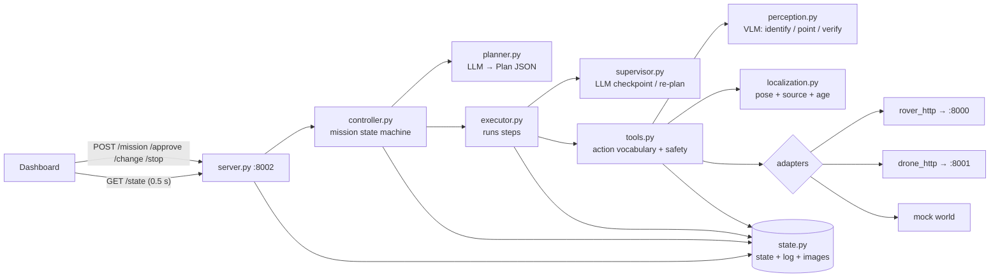
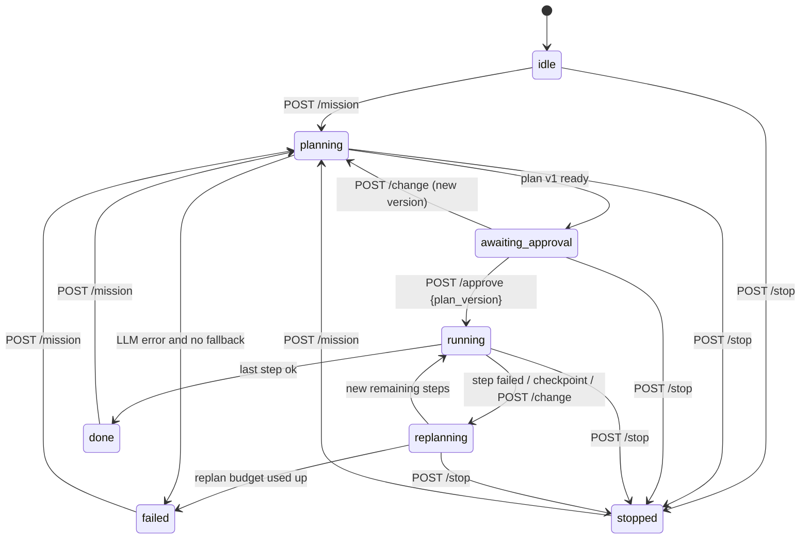

# AI Manager (`manager/`): implementation plan

> **Scope update (Sat afternoon):** the demo is now drone recovery from farmland, with no docking and the dashboard served by the mothership. The work packages and contracts agents should build against are in **[mothership-plan.md](mothership-plan.md)**, which wins where the two disagree. This file remains the design rationale (plan → approve → execute, safety in code, threading rules in §17).

**Owner:** AI manager squad (Het + 1) · **Branch:** `feat/ai-manager` · **Port:** 8002
**Deadlines (from the Team Plan):** full mission on fake robots **Sat 15:00** · on real robots **Sun 11:00** · feature freeze **Sun 13:30**

---

## Status (updated 2026-10-10)

| Milestone | State |
| --- | --- |
| **P0** models, adapter protocols, `/state` contract | ✅ done: `manager/models.py`, `adapters/base.py`, §9 |
| **P1** mock world + adapters + tools + executor, `/state` served | ✅ done |
| **P2** text → LLM plan → Approve → full run on mocks | ✅ done with a **scripted** LLM and with the canned plan; **not yet run against live Gemini** (needs the key; `pytest -m live` is the first-hour check, §11) |
| **P3** Stop / change / replan, `rover_http` on the real EP, grip line, `rover_approach` on the real camera | 🟡 Stop / change / replan ✅ on mocks. `rover_http` ✅ against a fake server. **Nothing touched a real robot yet** |
| **P4 / P5** real robots, dock mode, 10-run metrics | ⬜ not started |

Run it: see [README → AI manager quick start](../README.md#ai-manager-quick-start). ~300 tests run on mocks in ~13 s (`pytest`), plus opt-in live Gemini (`pytest -m live`) and real-browser (`pytest -m ui`) tests; `arena.json` values are **placeholders** until measured on the floor.

---

## 0. In one paragraph

The manager is the only component that talks to the LLM. It turns one sentence into a **structured plan**, waits for a human to **Approve** that exact plan, **executes** it step by step through robot adapters, **verifies** results with the rover camera, and **re-plans** when a step fails or a human types a change. It reaches robots only over HTTP (rover `:8000`, drone `:8001`) and serves its own state to the dashboard on `:8002`. It runs against a mock world first (`MOCK=1`). The same mock is our Level-3 backup demo.

---

## 1. Boundaries: what we build and what we don't

| Squad | Owns | We touch it? |
| --- | --- | --- |
| **AI manager (us)** | Planner, executor, tools, safety rules, mission state, HTTP API `:8002`, mock world, HTTP clients for the robot servers | Yes, everything in `manager/` |
| Drone | `cflib`, Lighthouse, takeoff / goto / scan / land / **dock**, battery, the `zrange` "object below" detection → HTTP `:8001` | **No.** We call its HTTP API. The `cflib` code in `fleet.py` moves to them |
| Rover | `robot_server.py` (RoboMaster SDK) → HTTP `:8000` | No. We call its HTTP API |
| Shared map | Rover pose in the Lighthouse frame (docked drone / rider / odometry), plate offset calibration | No. We consume `/pose` and decide *when* to re-anchor |
| Dashboard | UI | No. They build against our `/state` contract (§9) |

**We do not write `cflib`, RoboMaster SDK or ROS code.** No hardware library gets imported inside `manager/`, ever. Everything robot-specific sits behind an HTTP server another squad owns.

What we reuse from the starter code:

- `fleet.py` → its four LLM tools become `manager/tools.py`; its drone flight code goes to the drone squad.
- `brain.py` → its look → act → look loop becomes `rover_approach` (§6).
- `fleet_agent.py` → not used (ROS backup path only).

---

## 2. Architecture



### Key design choice: plan-and-execute, not free-running tool calls

The starter code (`fleet.py`, `brain.py`) gives the LLM tools and lets the SDK's *automatic function calling* run the whole mission inside one opaque call. That cannot support **Approve before acting**, a **live step list** on the dashboard, or **Stop between actions**. So:

1. **Plan:** the LLM writes a plan as JSON in a fixed action vocabulary (§5). No robot moves.
2. **Approve:** a human approves that exact plan version.
3. **Execute:** *our code* runs the steps one at a time through adapters. That makes them deterministic, logged, and stoppable between any two steps.
4. **Checkpoint:** the LLM comes back only when there is something to decide: after a scan (which finding to go to), after an inspect (is this the thing?), on a failed step, or when a human types a change. It returns a decision plus the new remaining steps.

---

## 3. Module layout

```
manager/
  __init__.py
  config.py          env vars, ports, model names, timeouts, speed caps
  arena.json         arena bounds, drone cage rect, named zones ("exit", "charging_station",
                     "left_half"), home pose, grip-line pixel row: MEASURED ON THE FLOOR
  models.py          pydantic: Pose, Finding, Step, Plan, SupervisorDecision, MissionState
  state.py           thread-safe store, event log, JPEG store, to_json() for /state
  adapters/
    base.py          RoverAdapter / DroneAdapter protocols (the only thing tools see)
    rover_http.py    client for robot_server :8000
    drone_http.py    client for drone server :8001
    mock.py          MockWorld, MockRover, MockDrone (+ failure injection)
  localization.py    rover pose = latest absolute fix + odometry since; exposes source + age
  llm.py             the only Gemini caller: structured output, model fallback chain, runs/ logs, ScriptedLLM
  perception.py      Gemini ER calls (identify, point-to-target, "is it in the gripper?") + ground-truth mock
  tools.py           the action vocabulary (§5): validate args → safety → adapter → state
  safety.py          geofence, caps, mentor gate, stop_all()
  planner.py         mission text + arena + robot status → Plan (structured output)
  supervisor.py      checkpoint / failure / human change → SupervisorDecision
  executor.py        runs steps, resolves $references, timeouts, retry budget
  controller.py      mission state machine (§4), owns the worker thread
  fallback_plans.py  canned plan for the demo mission if the LLM is down
  server.py          FastAPI app on :8002 (CORS on)
  runtime.py         config -> adapters -> Ctx -> Controller (ROVER and DRONE chosen independently)
  cli.py             python -m manager.cli "mission text" [--auto-approve] [--mentor]
tests/
  test_tools.py  test_controller.py  test_mission_mock.py  test_server.py  test_planning.py
  test_llm.py  test_http_adapters.py (+ fake_robot_servers.py)  test_live.py (opt-in, hits Gemini)
```

Dependencies: `requirements-manager.txt` (`google-genai requests fastapi uvicorn pydantic pytest httpx pillow`; Pillow renders the mock camera). Python 3.10+ (developed on 3.12; the Mac's default `python3` is 3.9, so use `uv venv --python 3.12 .venv`), runs on a Mac. The rover's Python 3.8 Windows laptop is not involved.

Robot selection is one env var per robot, so mixed mode works (real rover + mock drone = Level 3):

```bash
ROVER=mock|http://<win-ip>:8000   DRONE=mock|http://<drone-ip>:8001   MODEL=gemini-robotics-er-2-preview
```

---

## 4. Mission lifecycle



Rules:

- **Stale approvals are rejected.** `/approve` carries `plan_version`. If the plan changed since the human looked at it, the server returns `409`.
- **Change while running:** the current *atomic* step finishes (every step is capped at a few seconds of motion), then the plan is replanned. `CHANGE_NEEDS_APPROVAL=0` (the demo default) treats the typed change as the approval and applies it live. The dashboard shows the old and new plans side by side. With `=1`, the mission goes back to `awaiting_approval`.
- **Stop never goes through the LLM** (§8).
- **Replan budget:** at most 2 replans per failed step and 6 per mission, then `failed` with a report.

---

## 5. Action vocabulary (the tools)

All coordinates are **metres in the Lighthouse frame**. Targets can be raw `x, y`, a zone name, or a finding id. Each tool validates its arguments, checks safety, calls an adapter, writes to the state log, and **returns a dict. It never raises into the planner.**

| Tool | Robot | Args | Returns | Notes |
| --- | --- | --- | --- | --- |
| `drone_scan` | drone | `zone` or `x0,y0,x1,y1` | `{findings:[{id,x,y,dz,by}]}` | Takes off from where it is (the plate), sweeps, returns. Mentor gate + cage geofence |
| `drone_goto` | drone | `x,y,z` | `{ok,pose}` | Cage geofence |
| `drone_dock` | drone | none | `{ok,docked}` | Land on the EP plate (§7). Rover must be stationary |
| `drone_land` | drone | none | `{ok}` | Land in place (fallback) |
| `rover_goto` | rover | `target` | `{arrived,pose,pose_source,error_m}` | Coarse metric navigation, ±~30 cm is fine |
| `rover_search` | rover | `target` | `{found,bearing_deg,image_id}` | Rotate in 45° steps; VLM points at target |
| `rover_approach` | rover | `target` | `{in_reach,steps,image_id}` | Camera-only visual servoing (§6) |
| `rover_inspect` | rover | `question` | `{answer,label,confidence,image_id}` | Evidence photo stored for the dashboard |
| `rover_grip` | rover | `open`/`close` | `{ok}` | |
| `rover_check_grip` | rover | none | `{holding,image_id}` | VLM looks at the gripper |
| `rover_arm` | rover | `pick`/`carry`/`home` | `{ok}` | Presets, so no millimetres from the LLM |
| `report` | manager | `text, finding_id?` | `{ok}` | Message on the dashboard |
| `ask_human` | manager | `question` | `{answer}` | Pauses until the human replies via `/change` |

A plan step:

```json
{"id": "s3", "robot": "rover", "action": "rover_goto",
 "args": {"target": "$finding.f1"},
 "why": "Drive to the spot the drone flagged",
 "status": "pending", "result": null}
```

References resolved at run time: `$finding.<id>`, `$zone.<name>`, `$home`. If a step references a finding that doesn't exist yet, the executor triggers a supervisor checkpoint and does not guess.

**Typical demo plan:** `drone_scan(zone)` → checkpoint → `drone_dock` → `rover_goto($finding.f1)` → `rover_search` → `rover_inspect` → checkpoint ("is it the box blocking the exit?") → `rover_arm(pick)` → `rover_grip(open)` → `rover_approach` → `rover_grip(close)` → `rover_arm(carry)` → `rover_check_grip` → `rover_goto($home)` → `report`.

---

## 6. Perception with a camera only (no lidar on the EP)

What we have on the EP: **one forward monocular camera** and **mecanum wheel odometry**, which drifts, especially when strafing or when wheels slip. We may also have a DJI IR distance sensor; check the kit. There is no depth sensing. Distances a VLM guesses from one image are rough and change between frames, so **VLM distance estimates are never used for control.**

The strategy is coarse to fine:

1. **Where (metric, from Lighthouse).** Drone finding + rover pose get the rover to within about 30 cm of the object.
2. **What (VLM).** `rover_search` and `rover_inspect` identify the object and say whether it's grippable.
3. **How close (visual servoing, closed loop, stop-and-go).** `rover_approach` loops:
   1. Stop, take a snapshot, ask Gemini ER to *point* at the target. ER models return points as `[y, x]` normalised to 0–1000; convert to pixels.
   2. If the point is left or right of the image centre (outside a deadband), turn or strafe a little.
   3. If the point is above the **grip line**, move forward 10–15 cm. Otherwise the object is in reach, so stop.
   4. Repeat, up to 15 iterations or 60 s. If the target is lost, go back to `rover_search`.

   The **grip line** is the pixel row where an object sits when it is inside gripper reach. Calibrate it once on the floor: put the cup in the open gripper, take a snapshot, record the row in `arena.json`. This needs no depth and no distance estimate. It only compares where the object is in the image to a fixed line, which is why it holds up on a monocular camera.
4. **Verify.** After closing the gripper and lifting to `carry`, `rover_check_grip` asks "is there an object in the gripper?". If not: open, back off 10 cm, approach again (at most 2 retries).

Optional speed-ups, if the hardware has them: the IR distance sensor for the last 30 cm, and the RoboMaster SDK's built-in DJI vision-marker detection for lining up at home or the plate. The rover squad would have to expose both.

Cost: each VLM call takes roughly 1–3 s, so an approach is 5–10 calls. That is slow but reliable, and the demo is a video anyway. We measure it and report the number.

---

## 7. Localisation and the "drone rides the rover" (carrier) idea

**The idea:** a plate on top of the EP. The Crazyflie takes off from it, scans, and lands back on it.

**Why it helps us:**

1. **Rover pose without extra hardware.** While docked with motors off, the drone's Lighthouse pose *is* the rover's pose (plus a fixed, calibrated offset). This is the `fleet.py` "rider" trick without needing a second Crazyflie.
2. **Battery.** A Crazyflie flies only a few minutes per battery, so the drone flies only while scanning and rides the rest of the time.
3. **Shorter scans.** The rover carries the drone near the zone, so it scans locally.
4. **Charging (bonus).** Only if the drone squad gets a charging-capable pad working. Otherwise it is a landing pad, and we don't claim charging in the pitch.

**The one rule that makes docking easy:** *the rover does not move while the drone is out.* Then the plate is exactly where the drone took off, and the drone already knows that position from Lighthouse. Docking becomes "land at a known point at plate height". There is no tracking of a moving target and no camera on the drone. The executor enforces this rule: no rover motion tools run between `drone_scan` takeoff and `drone_dock`.

**What we are *not* doing:** hovering the drone live above the rover to guide it. Our Crazyflie has no camera (unless there's an AI deck), so it cannot follow the rover by sight. Docked mode gives the same pose benefit with far less risk.

**Practical notes for the drone and shared-map squads:** give the plate a low rim or pegs so the drone doesn't slide off while the rover drives. Keep rover acceleration low while the drone is docked. Calibrate the docked yaw offset once.

**Pose sources** (`localization.py`, in priority order; every pose in `/state` carries `source` and `age_s`):

| Source | When | Accuracy |
| --- | --- | --- |
| Docked drone (or rider) Lighthouse | Drone on the plate | Best (verify on the floor) |
| Last fix + wheel odometry | Drone out (rover should be still anyway) | Drifts with distance driven |
| Start cross + wheel odometry | No Lighthouse on the rover at all | Worst; shared-map option 2 |

**Credit:** another team (master's students here) uses a plate on the EP as a drone landing and charging point. If we use docking, we say so in the pitch ("docking inspired by …"). That is honest, and juries respect it. Our contribution is different: language → plan → human approval → multi-robot execution with camera verification and re-planning. Docking is one localisation and battery trick inside that.

---

## 8. Safety (in code, never only in the prompt)

- **Global stop:** `POST /stop` calls `safety.stop_all()`, which sends rover `/stop` and drone `/land` in parallel with a 1 s timeout, cancels the executor, and sets the state to `stopped`. It never involves the LLM, and it works from every state.
- **Mentor gate:** drone tools refuse unless `mentor_present=true` (a dashboard toggle → `POST /mentor`). Event rule, and a visible "human in control" point for the jury.
- **Geofence:** arena bounds for the rover and the cage rectangle for the drone. An out-of-bounds target makes the tool return an error, and the supervisor replans.
- **Caps:** rover ≤ 0.3 m/s, at most 1 m per relative move, a timeout on every step, mission timeout 10 min, replan budget (§4).
- **Drone battery:** recall and dock below a threshold read from the drone server's `/pose`.
- **Separation:** no rover motion while the drone takes off from or lands on the plate (§7).
- **Watchdog:** if a robot server doesn't answer for 2 s during motion, call `stop_all()` and mark the robot offline.
- **LLM output is validated** with pydantic before anything runs. An unknown action, robot or argument means the plan is rejected and re-requested once, then we use the fallback plan.

---

## 9. HTTP API on `:8002` (contract for the dashboard)

| Method | Path | Body | Effect |
| --- | --- | --- | --- |
| POST | `/mission` | `{"text": "..."}` | Start planning |
| POST | `/approve` | `{"plan_version": 3}` | Run that plan (`409` if stale) |
| POST | `/change` | `{"text": "..."}` | Human edit or answer to `ask_human` |
| POST | `/stop` | none | Emergency stop, any state |
| POST | `/mentor` | `{"present": true}` | Drone gate |
| POST | `/reset` | none | Back to `idle` (only when not running) |
| GET | `/state` | none | Everything the dashboard shows |
| GET | `/images/{id}.jpg` | none | Evidence photos |

`GET /state` shape (frozen once posted to the dashboard squad; only additive changes after that):

```json
{
  "mission": {"id": "m7", "text": "Check the test zone for anything blocking the exit",
              "status": "running", "plan_version": 2, "fallback": false},
  "plan": [
    {"id": "s1", "robot": "drone", "action": "drone_scan", "args": {"target": "$zone.exit"},
     "why": "Drone sweeps the exit area fast", "status": "done",
     "result": {"findings": [{"id": "f1", "x": 3.1, "y": 0.4}]}},
    {"id": "s2", "robot": "rover", "action": "rover_goto", "args": {"target": "$finding.f1"},
     "why": "Rover drives to the flagged spot", "status": "running", "result": null}
  ],
  "current_step": "s2",
  "robots": {
    "rover": {"online": true, "pose": {"x": 1.2, "y": 0.8, "yaw": 90.0},
              "pose_source": "docked_drone", "pose_age_s": 0.1, "holding": false},
    "drone": {"online": true, "pose": {"x": 1.2, "y": 0.8, "z": 0.27},
              "state": "docked", "battery_v": 3.9}
  },
  "findings": [{"id": "f1", "x": 3.1, "y": 0.4, "label": null, "confidence": null, "image_id": null}],
  "messages": [{"t": 1791620000.1, "role": "ai", "text": "Drone found 1 object near the exit."}],
  "last_image_id": "img_0012",
  "mentor_present": true,
  "metrics": {"llm_latency_ms_last": 1840, "rover_rtt_ms": 42}
}
```

---

## 10. What we need from other squads (send this list first)

**Rover (`robot_server.py`, `:8000`):**
- `/speed?x&y&z&t` **auto-stops after `t`**, so a lost link means a stopped robot.
- `/snapshot` returns a JPEG. `/stop` and `/grip?action=open|close` are already used by the starter code.
- **`/arm?preset=pick|carry|home`** (our default). If the rover squad only has relative `/arm?x&y` (millimetres), set `ROVER_ARM_MODE=relative` and tune `ARM_TARGETS` in `adapters/rover_http.py` on the floor.
- `/pose` → `{x, y, yaw}` from wheel odometry. We fuse it with the Lighthouse fix ourselves.
- **Agree on one sign for sideways `y`.** `brain.py` says +y = left, `fleet.py` flips it because the SDK uses +y = right. Pick one and write it in the README. Until then our client assumes **`/drive` y = left** and **`/speed` y = right** (the only evidence in the starter files) and exposes `ROVER_DRIVE_Y_SIGN` / `ROVER_SPEED_Y_SIGN` to flip either. First floor test: strafe left with `/speed` and check.
- Optional: the IR distance sensor reading, if the kit has one.

**Drone (`:8001`):**
- `/takeoff`, `/goto?x&y&z`, `/land`, `/scan?x0&y0&x1&y1` → `{"findings":[{"x","y","dz"}]}`.
- **New:** `/dock` (land at the stored takeoff pose and plate height).
- `/pose` → `{x, y, z, yaw, battery_v, state: "docked"|"flying"|"landed"}`. While docked, this *is* the rover's pose source.
- The server must be threaded, so `/land` works while a `/scan` is still running. Otherwise our Stop can't interrupt a scan.

**Shared map:** the plate's x/y/yaw offset relative to the rover centre, and the Lighthouse origin and axes measured in the arena.

**Dashboard:** build against §9 and `ROVER=mock DRONE=mock`. We'll have `/state` serving fake data by P1.

---

## 11. LLM usage (Gemini)

- **Models:** `MODEL` defaults to `gemini-robotics-er-2-preview`, with a fallback chain of ER 1.5 preview, then a Gemini Flash model. **First hour:** confirm the chosen model accepts *structured output + images* in one call, and measure latency.
- **Planner:** one call with `response_mime_type="application/json"` and `response_schema=Plan`. Inputs: mission text, arena zones, robots with capabilities and live status, the action vocabulary (generated from `tools.py` docstrings so the prompt never drifts from the code), and the rules ("drones find, rover verifies and fetches; rover stays still while the drone is out"). Temperature 0.2.
- **Supervisor:** returns `SupervisorDecision = {decision: continue|replan|done|abort|ask_human, reason, remaining_steps}`. The `reason` is shown on the dashboard as the AI's one-line explanation.
- **Perception:** ER pointing (`[{"point":[y,x],"label":...}]`, 0–1000), plus yes/no checks with the image attached.
- **No automatic function calling.** We need Approve and Stop between actions, so the executor calls tools itself.
- **Every LLM call is logged** to `runs/<timestamp>/` with prompt, response, latency, and images. This feeds the technical-depth story and the 10-run metrics.
- **Fallback:** if planning fails or takes longer than 15 s, we load the canned plan for the demo mission, and the dashboard shows "fallback plan".

---

## 12. Mock world

- The arena comes from `arena.json`. Objects are a list of `{label, x, y, image}`.
- **MockRover:** moves at 0.3 m/s (time can be sped up), adds odometry drift noise, and tracks gripper and arm state. `/snapshot` returns a real photo of whatever object is in its front cone, or an "empty floor" photo.
- **MockDrone:** a scan returns objects inside the rectangle with ±10 cm noise and occasional false positives. Battery drains while flying. It tracks docked / flying / landed.
- **Photos:** on Saturday, take phone photos at EP camera height (~20 cm) of the real objects: cup, box, empty floor, cup in the gripper. Then the VLM is tested on realistic images even in mock mode.
- **Failure injection:** `MOCK_FAIL=goto:0.2,grip:0.3` exercises replanning before the real robots ever do.

---

## 13. Testing

- **Unit:** argument validation and geofence in tools; `$reference` resolution; every state-machine transition, including Stop from every state; a stale `/approve` returns `409`.
- **Mission tests on mocks with recorded LLM responses:** deterministic, free, run on every change.
- **One live smoke test** (`pytest -m live`) that hits Gemini for real.
- **Metrics script:** run the demo mission N times and report success count, mean duration, and VLM latency. Also measure the rover round-trip time over 5G vs Wi-Fi (the two numbers the Team Plan wants).

---

## 14. Milestones

| By | Done when | Who |
| --- | --- | --- |
| **P0**, +30 min | `models.py`, adapter protocols and the `/state` example posted in Discord to the dashboard, rover and drone squads | Het |
| **P1**, ~13:30 | Mock world + adapters + tools + executor run a **hard-coded** plan; `server.py` serves `/state` | Teammate: server, state, mock · Het: tools, executor |
| **P2**, **Sat 15:00** | Mission text → LLM plan → Approve → full run on mocks, visible on the dashboard | Both |
| **P3**, Sat 18:00–22:00 | Stop, change and replan work; `rover_http` drives the real EP; grip line calibrated; `rover_approach` works on the real camera | Het: supervisor, perception · Teammate: rover_http, safety |
| **P4**, **Sun 11:00** | Full mission on real robots. Dock mode if the drone squad has it, otherwise rider or tape cross | Both + drone / shared map |
| **P5**, Sun 13:30 | Freeze. Fallback plan tested, 10-run metrics done, logs handed to Story & video | Both |

---

## 15. Risks and fallbacks

| Risk | Fallback |
| --- | --- |
| ER 2 preview is slow, errors, or rejects JSON + images | Model fallback chain; canned plan |
| Visual approach unreliable | Scripted approach: drive to the finding minus 25 cm, open, fixed forward move, close; camera only verifies |
| Docking on the plate fails | Rider (second Lighthouse deck) or tape cross + odometry; drone lands on the floor |
| Drone detection noisy | Take the finding with the largest `dz`; `rover_search` covers the rest |
| Wi-Fi / 5G drops | Watchdog `stop_all`; `/speed` auto-expires |
| No real drone flight available | Real rover + mock drone (Level 3, said openly) |

---

## 16. Open questions (check on the floor or with mentors)

1. Does our EP kit include the IR distance sensor?
2. Plate: size, height, mount. Is there a charging pad or deck, or is it just a landing pad?
3. Crazyflie model (2.1 or Brushless) and real flight time. Is a **Flow deck** fitted? The `zrange` object detection needs a downward range sensor.
4. Does Lighthouse cover the whole area the EP drives in, or only the cage?
5. Does the ER 2 preview accept structured output + images in one call, and how fast is it?

---

## 17. Implementation notes (decisions made while building; read before changing the code)

- **`StepDraft` is flat.** Gemini's response schema has no free-form dicts, so the LLM fills a flat model (`target`, `x`, `y`, `mode`, `question`, ...) and we turn it into `Step.args`. Adding a tool argument means adding a field there.
- **Planner returns drafts, the controller assigns step ids** when it commits the plan. A planner call that times out keeps running in a thread; if it assigned ids itself, its late finish would corrupt the numbering.
- **Epochs.** Every background job captures the cancel `Event` of the epoch it started in; `stop()`, a restarted plan and a new mission cancel it. A job that finishes after cancellation discards its result. Each run gets its own `Ctx` copy so a stale tool loop sees *its* cancel flag, not the new mission's.
- **Cross-cutting rules live in `tools.run_action`**, not in each tool: arg validation, mentor gate, "no rover motion while the drone is out", fault injection. The executor tracks `drone_out` from `drone_scan`/`drone_goto` until `drone_dock`/`drone_land`, and lands the drone if a mission ends with it still up.
- **`rover_goto` to a finding stops 0.6 m short** so the camera can see the object (a rover standing on it sees nothing). Zones are clipped to the flight cage for `drone_scan`.
- **Checkpoints:** `drone_scan`, `rover_inspect`, `ask_human` always go to the supervisor; failures and unresolved `$finding.*` references too. A failed `drone_dock` becomes `drone_land` (risk table, §15). A failed mentor gate becomes an `ask_human`.
- **Replan budget** is counted by the *original* failed step (retries inherit their lineage), so "2 per step" really holds even though a retry is a new step id. Human changes never consume budget.
- **`ask_human` is a step.** The supervisor's `ask_human` decision inserts one (plus a retry of the failed step); the answer arrives through `/change` and is returned as the step result.
- **No-LLM mode is a feature:** no `GEMINI_API_KEY` means the canned plan (flagged `fallback: true`) plus `RuleSupervisor`. A typed change cannot be applied in that mode, and the supervisor says so instead of pretending.
- **Mixed mode (real rover + mock drone):** a mock drone's "docked" pose is *not* used as the rover's fix (it would claim the rover never moves), so the rover falls back to start cross + odometry.
- **Mock perception is ground truth** read from the mock world (same projection that renders the image), so the grip-line loop is exercised for real; set `PERCEPTION=gemini` to send the synthetic frames to Gemini instead (not meaningful until we have the Saturday phone photos, §12).
- **`/state` additions** beyond the §9 example (additive, allowed): `mission.reason`, `mission.pending_question`, `mission.error`, `previous_plan` (for the side-by-side), `log`.
- **No auth on `:8002`** and CORS is open: anyone on the venue Wi-Fi can approve or stop. Fine for the hackathon (the dashboard runs on another laptop); put a token in front before any other use.
- **Not built yet:** mid-scan battery recall (the drone server owns the flight; we only refuse to launch below `DRONE_MIN_V`), metrics script (§13), Saturday photo set (§12).
