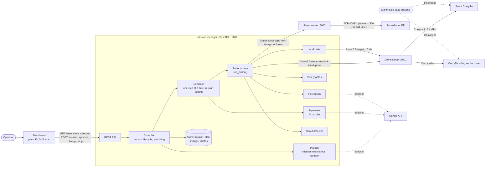
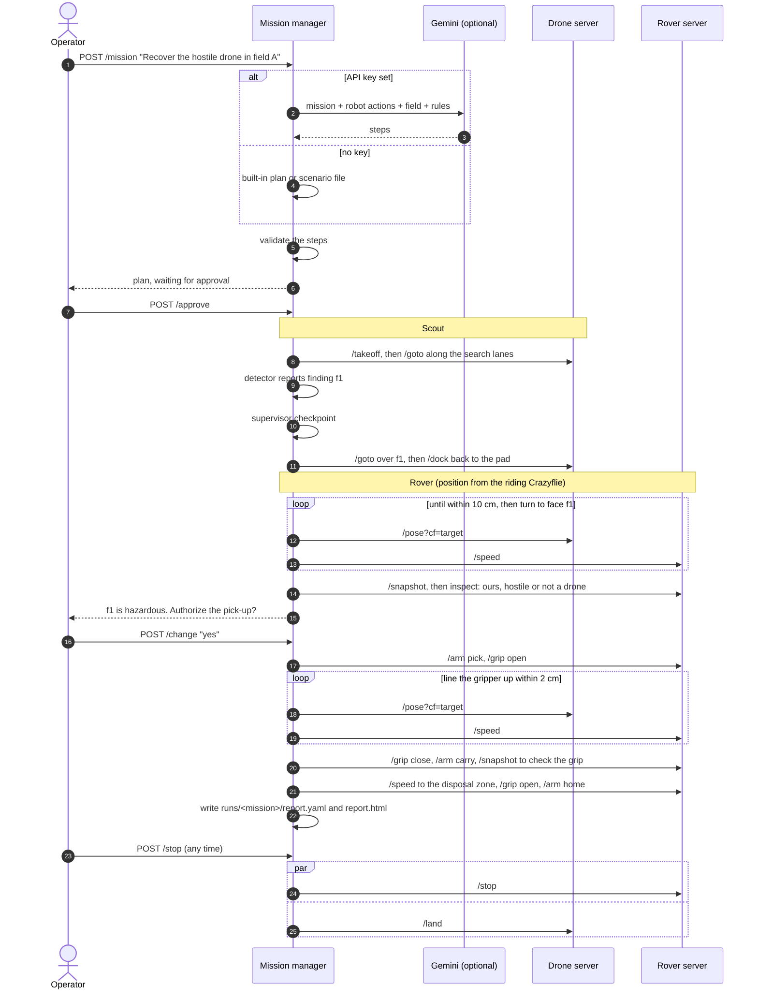
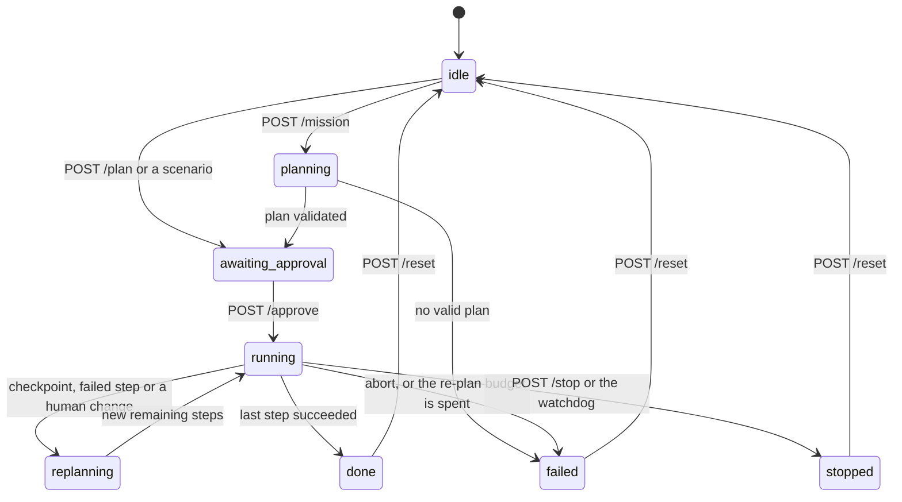
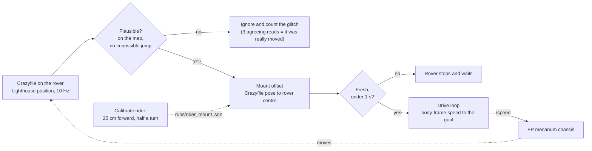
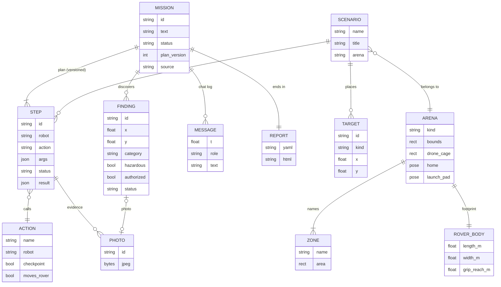

# Architecture

MARC is three small HTTP servers and a browser dashboard. Only the mission manager talks to the robot servers,
and every position is in metres in one frame: the Lighthouse tracking frame the scout flies in.

## Who talks to whom

| Piece | Code | Job |
| --- | --- | --- |
| Mission manager | [manager/](../manager/) | Plans, runs and supervises missions; enforces safety; serves the dashboard |
| Rover server | [rover/robot_server.py](../rover/robot_server.py) | Speaks the EP's plain-text SDK over TCP; keeps the link alive through Wi-Fi hiccups |
| Drone server | [drone/drone_server.py](../drone/drone_server.py) | Flies the scout with the Crazyflie high-level commander; reports both Crazyflies' Lighthouse poses |
| Camera streamer | [camera/stream_webcam.py](../camera/stream_webcam.py) | Serves an overhead webcam over HTTP for the optional overhead-camera module |

## A recovery mission, call by call

## Mission states

## How the plan adapts

After a checkpoint step (search, scan, inspect, a question to the operator) or any failure, the supervisor decides
what happens next: continue, re-plan the remaining steps, ask the operator, finish, or abort. With a Gemini key the
model decides and its answer is validated; without one, or when the answer is invalid, rules decide:

| Situation | Decision |
| --- | --- |
| The scout found nothing in field A | Ask the operator whether to search field B |
| The rover's camera says it is one of ours | Deliver it to base instead of the disposal zone |
| It is not a drone | Finish and leave it |
| It cannot be gripped | Drop the pick-up steps and report it |
| The operator does not authorize | Finish and leave it where it is |
| A step failed | Retry it once, then abort |
| A robot stopped answering | Abort |

## Where the rover is

The EP's wheel odometry drifts and the Crazyflie on top of it does not, so the riding Crazyflie is the rover's
only position source (`ROVER_RIDER=target`). `ROVER_RIDER_MODE=blend` switches back to the rider plus wheel
odometry. Without a rider, the rover starts from a taped start cross and counts wheel turns.

## Data model

A finding is created by the scout and becomes the rover's goal. Plans refer to it as `$finding.f1` before it
exists, and the reference is resolved when the step runs. The same goes for `$zone.disposal`, `$home` and
`$start` (where the rover was when the mission began).

## Safety, in code

| Rule | Where |
| --- | --- |
| The drone is locked until the safety pilot switch is on | `Safety.mentor_gate`, every drone action |
| Flight targets stay inside the measured flight cage; the drone server refuses the rest | `Safety.drone_target`, `drone_server._outside_cage` |
| A lost Lighthouse position is never used, even with the geofence off | `drone_server._sane`, `RiderLocalization` |
| A low drone keeps 0.5 m from where the rover is going | `tools._separation_violation` |
| The gripper does not close on a hazardous finding without the operator's yes | `tools._authorization_gate` |
| Speeds and single moves are capped | `Safety.clamp_speed`, `Safety.clamp_move`, the rover server |
| A robot that stops answering stops the mission | `Monitor` watchdog |
| STOP halts the rover and lands the drone in parallel, without the AI | `Safety.stop_all` |
