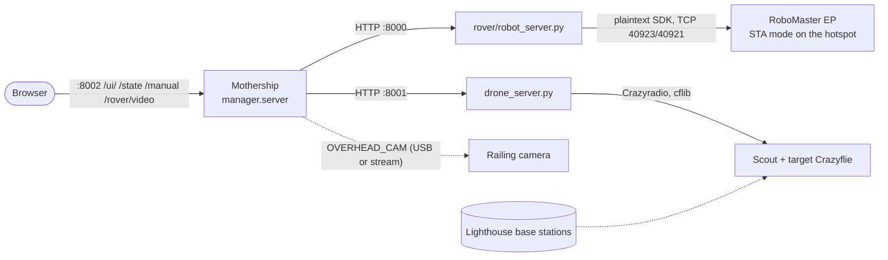

# Integration plan: rover, drone, mothership, railing camera

Status on 2026-10-10, after merging every branch into `feat/ai-manager`. Read this first if you join now; the older
plans ([mothership-plan.md](mothership-plan.md), [ai-manager-plan.md](ai-manager-plan.md)) hold the design detail.

## 1. Where everything is

| Branch | What it had | State |
| --- | --- | --- |
| `feat/ai-manager` | Mothership (planner, executor, safety, dashboard), rover API server | **The integration branch.** Everything below is merged into it |
| `mac-dev-tasks` (drone squad) | `drone_server.py`, `calibration.yaml`, `scan_drones.py`, a Flask placeholder rover server | Merged. The placeholder was removed: `rover/robot_server.py` replaces it |
| `rover` (rover squad) | `rover/control1.py` teleop + README | Merged earlier (WP-R1) |
| `feat/overhead-camera` (local) | Overhead webcam: ArUco calibration, rover tag, `camera_locate` | Merged, and generalised to a camera at any angle |
| `main` | The first plan only | Behind by everything: merge `feat/ai-manager` into it with a PR when the team agrees |

## 2. How the pieces talk



- **One frame for everything:** the Lighthouse frame from `calibration.yaml`, metres, yaw in degrees counter-clockwise.
  Its origin is inside the net, so coordinates go negative. The mothership loads it with
  `ARENA=manager/arena.floor.json`; plain `arena.json` is the mock/test world (0..4 × 0..3) and stays that way so
  the tests never depend on floor measurements.
- **Two geofences for the drone, kept equal by a test:** `drone_server.py DEFAULT_CAGE` and
  `arena.floor.json drone_cage`. Re-measure → change both (`tests/test_integration.py` fails until you do).
- **Rover body frame:** x forward, y left, z turn-left, on every rover endpoint. The rover server converts to DJI's
  signs; the floor check passed on the real EP.
- **The browser only talks to `:8002`.** The rover's live video is relayed (`GET /rover/video`), so the dashboard works
  from any laptop on the hotspot without knowing where the robot servers run.

## 3. Running it

`python start.py demo | sim | floor` starts whatever is needed and skips (with a one-line reason) whatever cannot
start; see the README's Getting started. By hand, the same three processes:

```bash
ROBOT_HOST=<ep-ip> .venv/bin/python rover/robot_server.py      # :8000  rover (MOCK=1: fake EP)
.venv/bin/python drone_server.py                                # :8001  drone (MOCK=1: no radio)
ARENA=manager/arena.floor.json ROVER=http://localhost:8000 DRONE=http://localhost:8001 \
  .venv/bin/python -m manager.server                            # :8002  mothership + dashboard
```

Any piece can be a mock: `ROVER=mock` / `DRONE=mock` in the mothership, or `MOCK=1` on a server (which tests the real
HTTP path). Without `GEMINI_API_KEY` the mothership still starts: manual control and scripted plans work up to the
first step that has to read the rover camera, which then fails with the reason.

## 4. What is verified, and what is not

| Piece | Verified | Not yet |
| --- | --- | --- |
| Rover server | Real EP over STA: health, pose, camera, drive; direction signs correct | Arm presets (placeholders), `/stop` interrupting a long `/drive`, odometry scale (0.2 m read as 0.27 m once) |
| Drone server | Flown on the real scout (drone squad) | Target Crazyflie (`TARGET_URI`) in a full run |
| Mothership ↔ servers | Every manual action through both real server processes (mock EP / mock radio); dashboard in headless Chromium | A full mission on the floor |
| Floor arena | Cage and net corners measured | Zones, home cross, overhead tags: provisional numbers |
| Railing camera | Pipeline on synthetic frames, any angle | Any real frame from the mounted camera |

## 5. Work packages

### F1 Floor bring-up (everyone, with a mentor)

1. **Fourth net corner:** re-measure it (it lost tracking) and correct `bounds` in `arena.floor.json`.
2. **Zones and home:** decide where `base`, `disposal`, `field_a`, `field_b` really are; measure them with the target
   Crazyflie as a wand; tape the rover's start cross and enter it as `home` (facing +x). Set `"calibrated": true`.
3. **Rover:** tune `ARM_PRESETS` (`curl $R/arm` reads the pose), test `/stop` during `/drive?x=1`, measure a 1 m drive
   against the tape for the odometry scale.
4. **Scenarios for the floor:** `t2_mark_and_drive` and `t3_recover_hostile` hard-code `"2.4,1.1"` from the mock world.
   Add floor copies that use `$zone.field_a` or the target's measured spot.
5. `fleet.py` still sends `SIGN_Y = -1`; with the rover server it must be `+1` (only matters if anyone runs `fleet.py`).

### C Railing camera (camera pair)

The code path exists (`manager/overhead.py`, `OVERHEAD_CAM=<index|url>`); these packages adapt it to the real mount.

- **C1 Mount and calibrate.** Fix the camera so it sees the whole net. Tape 4+ ArUco tags (`python -m manager.overhead
  tags`, print ≥ 20 cm for the far side, matte paper) flat on the floor just outside the net corners, measure their
  centres with the wand into `overhead.floor_tags`. Measure the lens height (`camera_height_m`) and the floor point
  straight below it (`camera_floor_xy`, may be outside the net). Check: `python -m manager.overhead check <cam> --save
  check.jpg` → the yellow outline must sit on the net, reprojection error a few cm.
- **C2 Rover marker.** Two options, pick one on the floor:
  - *ArUco tag on the rover* (built): gives position **and** heading; at a shallow viewing angle a flat tag gets
    squashed and may stop being detected. Tilting the tag towards the camera helps.
  - *Bright 3D-printed marker* (to build): an HSV colour threshold finds it at any angle and through motion blur. One
    colour gives position only (heading then comes from odometry); two colours (front/back) give heading too. Pick
    colours nobody else uses: red and blue already mean hostile/own drone on the cradle tape. Its height above the
    floor goes into the parallax correction like the tag's.
  Either way, the sighting becomes the rover's position fix (`pose_source: overhead_camera`) and removes the
  start-cross drift.
- **C3 Find objects.** `camera_locate` already asks Gemini to point at "the crashed drone" in the frame and maps the
  pixel to metres; it registers a finding the rover and the scout can use (`$finding.f1`). Floor test: does Gemini
  find the cradle at the camera's distance? If not: a colour detector for the cradle tape (same code as C2).
- **C4 Use it for the drones.** The camera turns any pixel into Lighthouse metres, so a camera finding can send the
  scout (`drone_mark "$finding.f1"`, or a click on the dashboard map → manual Go to). It can also cross-check the
  scout: a drone the camera sees far from its Lighthouse pose means tracking is wrong.

### I Integration leftovers (mothership)

- Show the overhead camera's status and the rover marker on the map once C1/C2 run (the card and `/overhead.jpg`
  exist).
- A floor `SCENARIO` that runs end to end without Gemini (scripted triage), for the video.

## 6. Open questions

1. Railing camera: which edge, how high, what resolution, USB into which laptop or an IP stream?
2. Does the camera pair have code outside this repo that should come in?
3. Rover marker: tag or coloured object (C2)?
4. Where are base and disposal physically, and does the rover drive inside the net?
